# Лабораторная работа №1
## Создание виртуального окружения. Контроллеры и маршруты

**Студент:** Власенко Александр Андреевич  
**Группа:** ПИЖ-б-о-25-1  
**Дисциплина:** Разработка web-приложений  
**Технологии:** Python, Django, PyCharm, `venv`  

---

## Содержание

- [Цель работы](#цель-работы)
- [Теоретическое обоснование](#теоретическое-обоснование)
- [Постановка задачи](#постановка-задачи)
- [Выполнение лабораторной работы](#выполнение-лабораторной-работы)
- [Проверка работы приложения](#проверка-работы-приложения)
- [Вывод](#вывод)
- [Ссылка на GitHub-репозиторий](#ссылка-на-github-репозиторий)

---

# Цель работы

Настроить изолированное виртуальное окружение Python, установить веб-фреймворк Django, создать проект и приложение, разработать контроллеры для обработки HTTP-запросов и организовать маршрутизацию между ними.

Дополнительная цель - освоить запуск встроенного сервера разработки Django, регистрацию приложений, использование `HttpResponse` и разделение маршрутов проекта и отдельного приложения.

---

# Теоретическое обоснование

**Виртуальное окружение** - изолированная среда Python, в которой устанавливаются зависимости конкретного проекта. Модуль `venv` позволяет отделить набор библиотек проекта от глобальных пакетов интерпретатора. После активации окружения команды `python` и `pip` используют соответствующие исполняемые файлы и установленные пакеты.

**Django** - веб-фреймворк Python, предоставляющий средства для конфигурации проекта, обработки HTTP-запросов, маршрутизации, работы с базой данных и администрирования. Django организует обработку запросов по архитектуре MTV (Model–Template–View). В рамках данной работы используются представления (`views`) и система URL-маршрутов.

**Контроллер (представление, view)** - функция или класс, обрабатывающий входящий HTTP-запрос и формирующий ответ. Функциональное представление получает объект `HttpRequest` через аргумент `request`; простой текстовый или HTML-ответ можно вернуть с помощью `HttpResponse`.

**Маршрутизация** - сопоставление URL-адресов с обработчиками запросов. В Django маршруты задаются функцией `path()` в списке `urlpatterns`. Функция `include()` позволяет подключать маршруты отдельного приложения к основному маршрутизатору проекта, формируя вложенные пути.

**Сервер разработки** запускается командой `python manage.py runserver`. Он предназначен для локальной отладки, по умолчанию доступен по адресу `http://127.0.0.1:8000/` и отображает сведения о запросах в терминале. Для развёртывания в производственной среде используется другой способ запуска.

---

# Постановка задачи

В соответствии с методическими указаниями необходимо:

1. Создать и активировать виртуальное окружение Python, проверить список установленных пакетов.
2. Установить Django и создать проект `MySite`.
3. Запустить сервер разработки и убедиться, что стартовая страница доступна в браузере.
4. Создать приложение `news` и зарегистрировать его в `INSTALLED_APPS`.
5. Реализовать представления `index` и `test`, возвращающие HTTP-ответы.
6. Настроить маршруты для обоих представлений, а затем вынести маршрутизацию приложения в отдельный файл `news/urls.py`.
7. Проверить работу итоговых адресов `/news/` и `/news/test/`.

Отдельного индивидуального варианта методические указания не предусматривают, поэтому работа состоит из выполнения и проверки предложенного практического примера.

---

# Выполнение лабораторной работы

## 1. Создание и активация виртуального окружения

Работа выполнялась в PyCharm под Windows. Для проекта была создана рабочая директория `MyProject`, а внутри неё - виртуальное окружение `venv`. Для его создания может использоваться стандартная команда:

```bash
python -m venv venv
```

Активация в терминале Windows выполняется командой:

```bat
venv\Scripts\activate
```

После активации перед строкой приглашения появляется префикс `(venv)`. Проверка набора пакетов проведена командой:

```bash
pip list
```

Первоначальный список содержал только `pip`, что подтверждает использование отдельного окружения.

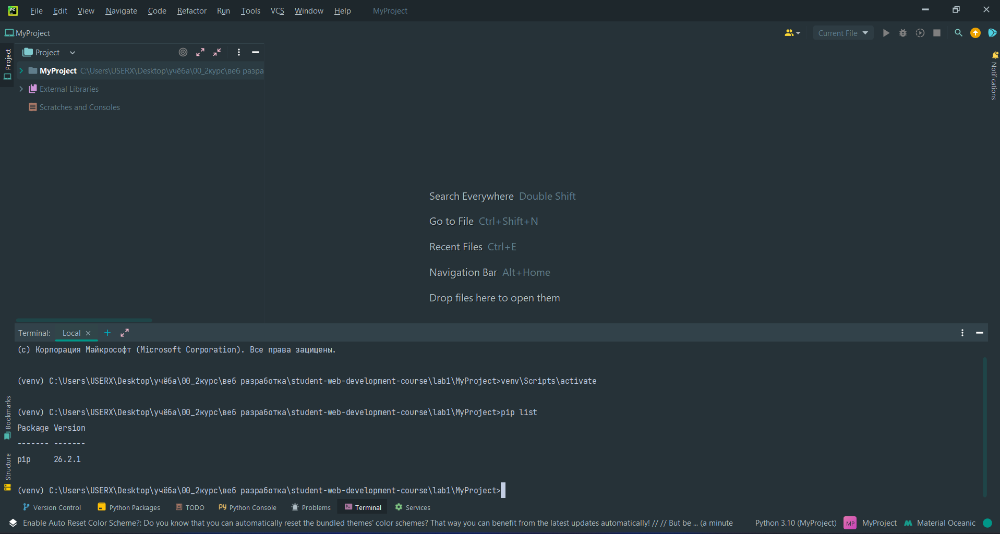

*Рисунок 1 - Активация `venv` и проверка пакетов через `pip list`.*

Структура окружения включает каталог `Lib` с библиотеками, `Scripts` с исполняемыми файлами и сценариями активации, а также конфигурационный файл `pyvenv.cfg`.

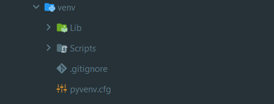

*Рисунок 2 - Содержимое виртуального окружения `venv`.*

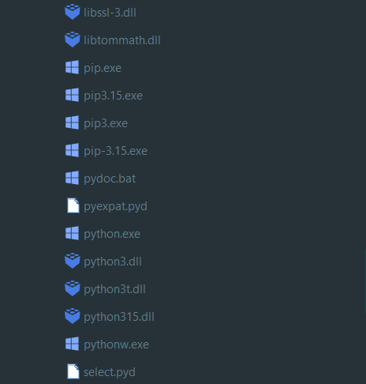

*Рисунок 3 - Файлы интерпретатора Python и `pip` в каталоге `Scripts`.*

---

## 2. Установка Django

В активированное виртуальное окружение устанавливается Django:

```bash
pip install Django
```

Повторный вызов `pip list` показал наличие Django версии **6.1.2** и необходимых зависимостей, в том числе `asgiref`, `sqlparse` и `tzdata`.

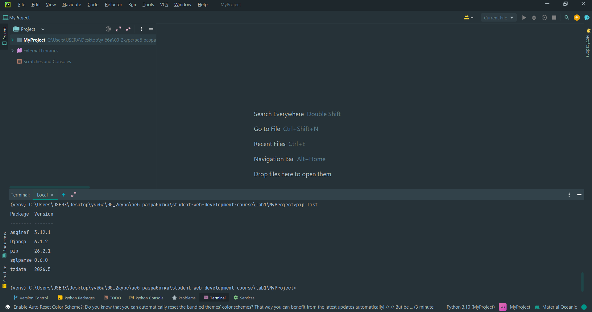

*Рисунок 4 - Список пакетов после установки Django.*

Для дополнительной проверки использовалась команда:

```bash
django-admin --version
```

Она вывела версию `6.1.2`.

---

## 3. Создание Django-проекта

Проект с именем `MySite` создан командой:

```bash
django-admin startproject MySite
```

В рабочей папке сформировался каталог `MySite`, включающий файл `manage.py` и одноимённый пакет конфигурации. В этом пакете располагаются `settings.py`, `urls.py`, `asgi.py` и `wsgi.py`.

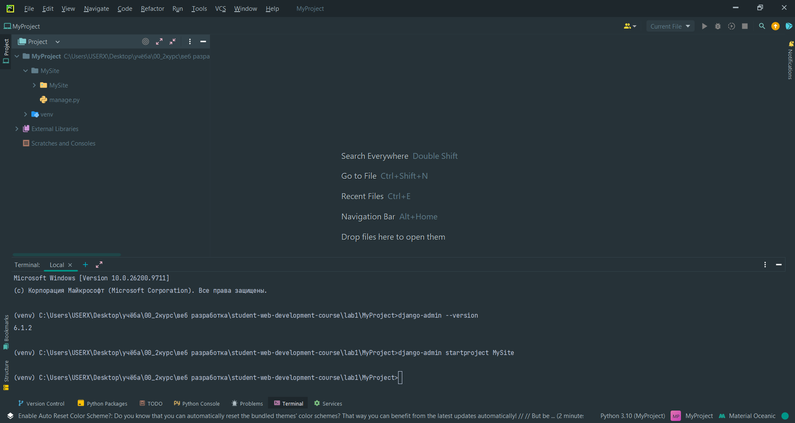

*Рисунок 5 - Команда `startproject` и структура созданного проекта.*

Назначение основных файлов:

- `manage.py` - интерфейс управления проектом из командной строки;
- `settings.py` - настройки Django и список подключённых приложений;
- `urls.py` - маршруты проекта;
- `asgi.py` и `wsgi.py` - точки входа для запуска приложения в соответствующих серверных окружениях.

---

## 4. Запуск сервера разработки

После перехода в директорию, содержащую `manage.py`, выполнен запуск сервера:

```bash
cd MySite
python manage.py runserver
```

В браузере по адресу `http://127.0.0.1:8000/` отобразилась стандартная стартовая страница Django, что подтвердило корректное создание и запуск проекта.

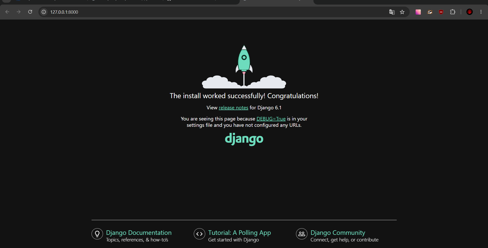

*Рисунок 6 - Стартовая страница Django на локальном сервере.*

Терминал зафиксировал запуск сервера и HTTP-запрос `GET /` с кодом ответа `200`. Также в журнале присутствует запрос к `/favicon.ico` со статусом `404`, поскольку отдельный значок сайта не был добавлен. Это не влияет на работу веб-приложения.

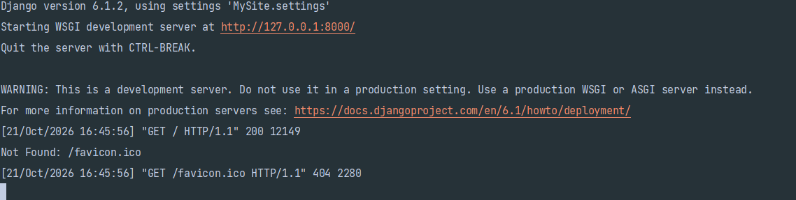

*Рисунок 7 - Запуск сервера и журнал HTTP-запросов.*

---

## 5. Создание и регистрация приложения `news`

Внутри проекта создано приложение `news`:

```bash
python manage.py startapp news
```

После выполнения команды появился каталог приложения со стандартными файлами `admin.py`, `apps.py`, `models.py`, `tests.py`, `views.py` и папкой `migrations`.

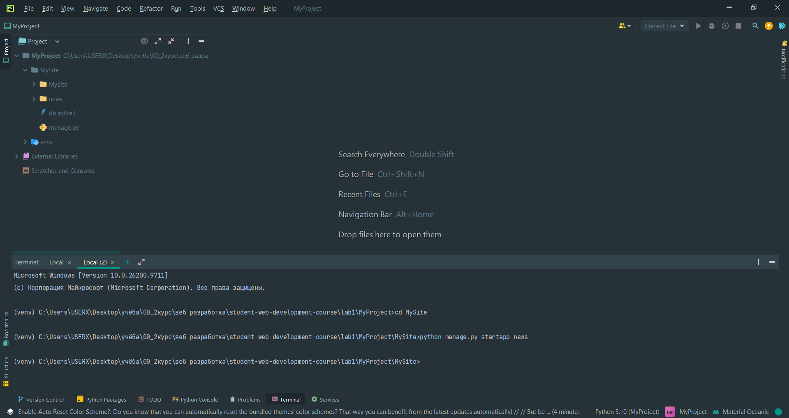

*Рисунок 8 - Создание приложения `news` командой `startapp`.*

Чтобы Django обнаруживал приложение, в файл `MySite/settings.py` добавлена строка в список `INSTALLED_APPS`:

```python
INSTALLED_APPS = [
    'django.contrib.admin',
    'django.contrib.auth',
    'django.contrib.contenttypes',
    'django.contrib.sessions',
    'django.contrib.messages',
    'django.contrib.staticfiles',
    'news.apps.NewsConfig',
]
```

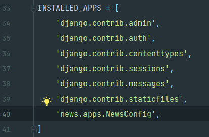

*Рисунок 9 - Регистрация `news.apps.NewsConfig` в `INSTALLED_APPS`.*

---

## 6. Создание представления `index`

В файле `news/views.py` создана функция `index`, принимающая объект HTTP-запроса и возвращающая текстовый ответ через `HttpResponse`.

```python
from django.http import HttpResponse


def index(request):
    print(request)
    return HttpResponse('Hello world')
```

Вызов `print(request)` позволяет увидеть сведения об обрабатываемом запросе в терминале. Дополнительно в рамках изучения объекта запроса рассматривался вызов `print(dir(request))`, выводящий доступные атрибуты и методы.

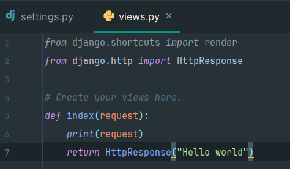

*Рисунок 10 - Реализация представления `index`.*

Для первоначальной проверки в основном файле `MySite/urls.py` был указан прямой маршрут к функции `index`:

```python
from news.views import index

urlpatterns = [
    path('admin/', admin.site.urls),
    path('news/', index),
]
```

Здесь `path()` связывает путь `news/` с обработчиком `index`. Приведён основной фрагмент настройки; импорты `admin` и `path` используются в этом же файле.

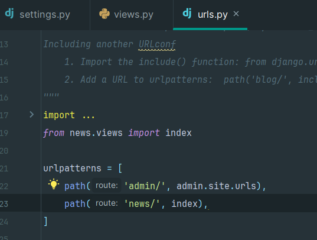

*Рисунок 11 - Прямое сопоставление `/news/` с функцией `index`.*

При переходе на `http://127.0.0.1:8000/news/` в браузере отобразилась строка `Hello world`.


*Рисунок 12 - Результат обработки запроса к `/news/`.*

---

## 7. Добавление представления `test`

Следующим шагом в файл `news/views.py` добавлена вторая функция, возвращающая HTML-заголовок. Итоговое содержимое с двумя обработчиками можно представить следующим образом:

```python
from django.http import HttpResponse


def index(request):
    print(request)
    # print(dir(request))
    return HttpResponse('Hello world')


def test(request):
    return HttpResponse('<h1>Тестовая страница</h1>')
```

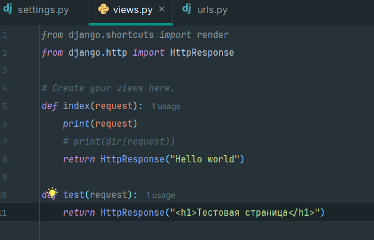

*Рисунок 13 - Представления `index` и `test` в файле `views.py`.*

На промежуточном этапе оба маршрута находились в основном `urls.py` проекта:

```python
from news.views import index, test

urlpatterns = [
    path('admin/', admin.site.urls),
    path('news/', index),
    path('test/', test),
]
```

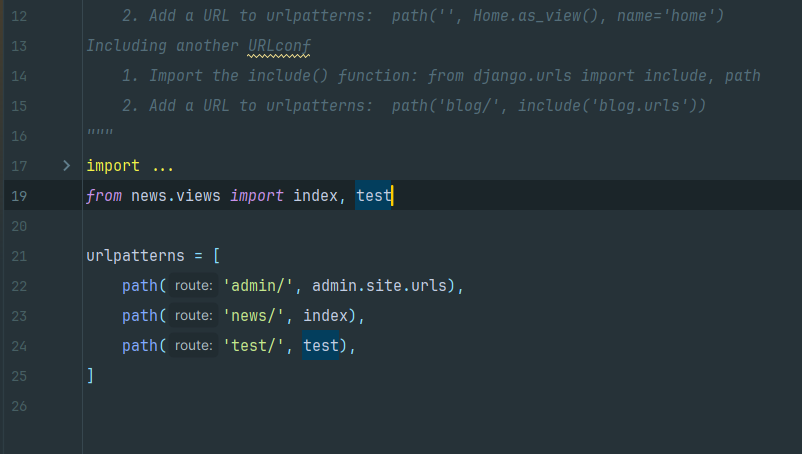

*Рисунок 14 - Прямая регистрация двух маршрутов в проекте.*

Адрес `http://127.0.0.1:8000/test/` успешно открывал HTML-страницу с заголовком «Тестовая страница».

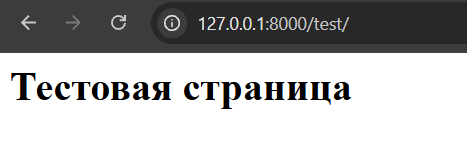

*Рисунок 15 - Промежуточная проверка маршрута `/test/`.*

---

## 8. Организация вложенных маршрутов приложения

По условию практического примера тестовая страница должна находиться внутри приложения `news`, а не в корне сайта. Для этого маршрутизация была разделена между конфигурацией проекта и конфигурацией приложения.

В `MySite/urls.py` основной путь `news/` подключён через `include()`:

```python
from django.contrib import admin
from django.urls import path, include

urlpatterns = [
    path('admin/', admin.site.urls),
    path('news/', include('news.urls')),
]
```

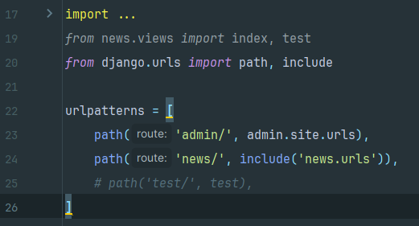

*Рисунок 16 - Подключение маршрутов `news.urls` с помощью `include()`.*

В каталоге `news` создан файл `urls.py`, содержащий собственные маршруты приложения:

```python
from django.urls import path
from .views import index, test

urlpatterns = [
    path('', index),
    path('test/', test),
]
```

На скриншоте обработчики импортируются из `.views` с помощью `*`; выше представлен эквивалентный вариант с явным перечислением двух функций.

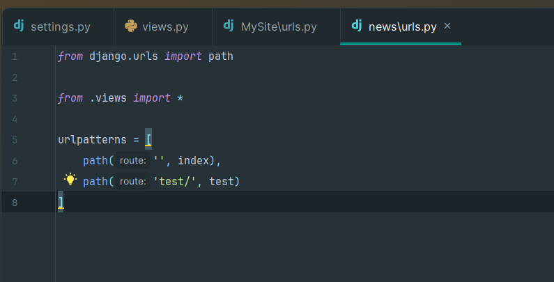

*Рисунок 17 - Список `urlpatterns` в `news/urls.py`.*

Теперь Django последовательно сопоставляет части пути: префикс `news/` обрабатывается маршрутизатором проекта, а оставшаяся часть - маршрутизатором приложения. Поэтому `path('', index)` соответствует `/news/`, а `path('test/', test)` - `/news/test/`.

---

# Проверка работы приложения

Для проверки использовался веб-браузер и локальный сервер Django по адресу `http://127.0.0.1:8000/`.

| Адрес | Обработчик | Результат |
|---|---|---|
| `/` | Стандартный обработчик Django до настройки маршрутов | Отображена стартовая страница Django |
| `/news/` | `index` из `news/views.py` | Текст `Hello world` |
| `/test/` | `test` (промежуточный маршрут) | Заголовок «Тестовая страница» |
| `/news/test/` | `test` через `include('news.urls')` | Заголовок «Тестовая страница» |

**Итоговая проверка:** после переноса маршрутов в отдельный файл страница стала доступна по адресу:

```text
GET http://127.0.0.1:8000/news/test/
```

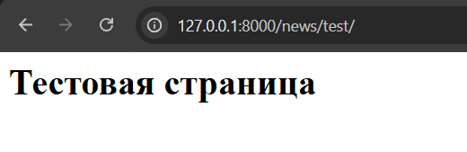

*Рисунок 18 - Итоговая проверка вложенного URL `/news/test/`.*

Таким образом, оба обработчика работают внутри приложения `news`, а основной файл маршрутизации отвечает только за подключение URL-префикса приложения. Прямой маршрут `/test/`, использовавшийся для промежуточной проверки, в итоговой конфигурации больше не требуется.

---

# Вывод

В ходе лабораторной работы было настроено виртуальное окружение Python и установлен фреймворк Django. Создан проект `MySite`, запущен встроенный сервер разработки и проверена доступность стартовой страницы в браузере.

Разработано приложение `news`, зарегистрированное в настройках Django. Реализованы две функции-представления: `index` для выдачи простого текстового ответа и `test` для возврата HTML-заголовка. На практике изучены объект `request`, класс `HttpResponse` и сопоставление URL с обработчиками через `path()`.

Заключительным этапом стало разделение маршрутов по уровням: основной файл `MySite/urls.py` подключает маршруты приложения через `include()`, а файл `news/urls.py` определяет адреса внутри приложения. В браузере проверена работа итогового вложенного маршрута `/news/test/`.

**Цель лабораторной работы достигнута:** освоены основные этапы подготовки Django-проекта, создания контроллеров и организации маршрутизации веб-приложения.

---

# Ссылка на GitHub-репозиторий

https://github.com/lostmoth/student-web-development-course
